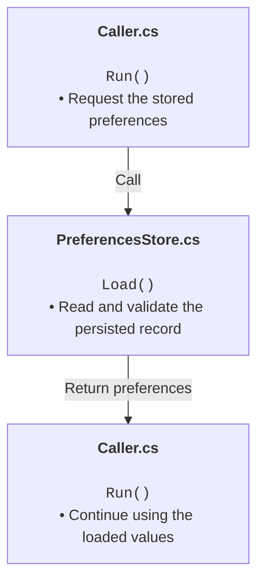

# Execution charts

## Overview

Explain an actual code path using Mermaid flowcharts. Each block represents execution in one source file and lists the functions or call sites reached there, with a short explanation underneath each code label. Repeat file blocks when execution returns to a file so the chart reads in execution order rather than as an architecture map.

## Prerequisites

* Follow the workspace's applicable guidance and shared-work boundaries before tracing or saving charts.
* Read the actual source for the requested path. Documentation and semantic search are starting points, not proof of current implementation.
* No scripts or extra packages are required to author charts. A compatible Mermaid renderer is needed to verify rendering and typography.

## Quick start

```text
/execution-charts explain how settings load during startup
/execution-charts chart completed-score saving and save it under docs/charts
```

Natural-language requests for file-by-file execution charts should also match this skill's description. Invocation and renderer support must not be claimed as verified without observing them.

## Parameters reference

| Input | Default | Purpose |
|-------|---------|---------|
| Process or entry point | Infer from the request and selected code | Bound the execution path to explain |
| Scenario | Relevant normal path, with important alternate outcomes identified | Distinguish startup, callbacks, failure paths, and unused APIs |
| Output | Chat unless saving is requested | Save requested Markdown charts under the user's location, normally `docs/charts` |
| Filename | Lowercase kebab-case describing the process | Prefer names such as `load-workshop-settings.md`, not generic chart numbers |
| Detail | Enough to explain execution and state changes | Omit unrelated internals explicitly and split large lifecycle phases into linked charts |

## Script reference

No scripts are bundled. Use the available source-navigation, file-editing, and rendering tools.

### Tracing and authoring

1. Identify the entry point, scenario, relevant source files, and required output. Ask only when an unresolved scope choice materially changes the trace.
2. Follow the continuous call path directly. Resolve constructors, virtual dispatch, callbacks, queued work, and returns from source. Distinguish an inherited framework method from a method declared in the caller's file.
3. Check whether the path is actually invoked. Mark an unused API or proposed caller explicitly; do not draw it as active application behavior.
4. Draw in execution order. A synchronous call must finish before the caller continues. Label deferred callbacks, queues, thread changes, and true concurrency only when supported by the implementation. Multiple entry points must have their sequencing or independence explained.
5. Give every code block one filename, with a library or project qualifier when needed to distinguish duplicate names. Repeat the file when execution leaves and later returns. Keep consecutive functions in one block only when no relevant cross-file handoff intervenes; label condensed loops or omitted calls.
6. Use bold file headers, monospace code labels, and normal prose descriptions on separate lines. Prefix each description with a bullet (`&bull; ` in the Mermaid source) to distinguish it from code. Do not append `//` explanations to function signatures. Omit trailing periods/full stops from chart descriptions and edge labels; preserve dots within code names and filenames. This chart-label style does not change punctuation in surrounding documentation. Use `<code>` for code and `<br/>` for spacing inside quoted Mermaid labels, with the configuration shown below.
7. Include material branches and early returns, or state which paths are condensed. Keep decisions in their owning file's blocks where practical. Label arrows with calls, returned values, conditions, or scheduling boundaries instead of implying every arrow is a direct call.
8. When saving, follow the repository's Markdown metadata/style guidance, use one process-named file per chart page, and include relative source links. Introduce each chart with one short sentence summarizing its execution sequence. Add only process-specific details essential to understanding it, such as a deferred callback, an unused API, or a consequential omission. Do not repeat explanations of file blocks, typography, returns, synchronous execution, or generic omissions across chart pages; convey execution semantics through the chart unless an exceptional detail needs clarification. Link related lifecycle phases rather than adding an unrequested index or duplicating the implementation reference.
9. Verify symbols and transitions against the trace. Check local links and Mermaid syntax, then render when tooling is available. Inspect that code is monospace, prose is readable, and labels are not clipped. Rendering and source inspection are not runtime acceptance tests. If validation is unavailable, state that limitation rather than silently adding repository dependencies.
10. Report the output locations and actual validation performed. Do not change application code, create shared tooling, run the application, or alter project standards merely to explain execution.

### Diagram template



The template is illustrative, not a claim that those files exist. Replace it with verified filenames and functions. Framework calls made inside a source file can appear in that file's block, but explain that they are call sites, not methods declared there.

## Troubleshooting

* If the chart looks like parallel execution, reconnect the actual lifecycle or split independent scenarios. Do not merge unrelated callers into an unexplained shared starting point.
* If a queued scene or callback appears to execute immediately, show both the scheduling call and the later dispatch before its body.
* If monospace labels or line breaks are lost, verify HTML-label support and renderer behavior. Do not claim the format works based only on parsing.
* If a label contains special characters, escape them for Mermaid and HTML. Keep signatures short rather than copying whole expressions or generic type declarations.
* If source changes during tracing, reconcile only the affected path before saving. Preserve unrelated edits.
* If no renderer is available, deliver the Mermaid source and disclose unverified rendering. Any tooling installation or shared configuration change needs its own appropriate scope.

## Attribution

> Brought to you by Calvnhd/mg-toybox
