After imports, the backup script parses arguments, validates paths, scans files,
then either previews the backup or creates, verifies, and reports the ZIP archive.

```mermaid
%%{init: {"flowchart": {"htmlLabels": true}, "themeCSS": ".nodeLabel code { font-family: ui-monospace, SFMono-Regular, Consolas, monospace; }"}}%%
flowchart TD
    START["<b>create_backup.py</b><br/><br/><code>__main__</code><br/><code>main(argv=None)</code><br/><code>ArgumentParser.parse_args(argv)</code><br/>&bull; Register --dry-run and parse arguments"]
    HELP(["Print help and exit 0"])
    USAGE(["Print argument error and exit 2"])

    SOURCE["<b>cli_utils.py</b><br/><br/><code>get_zip_source_path()</code><br/><code>load_dotenv()</code><br/>&bull; Load scripts/.env without replacing existing environment values<br/>&bull; Read ZIP_SOURCE_PATH<br/>&bull; Resolve against the working directory if relative<br/>&bull; Require an existing directory"]
    SOURCE_RETURN["<b>create_backup.py</b><br/><br/><code>main()</code><br/>&bull; Store the source path<br/>&bull; Request the destination path"]
    DEST["<b>cli_utils.py</b><br/><br/><code>get_zip_dest_path()</code><br/><code>load_dotenv()</code><br/>&bull; Load scripts/.env again<br/>&bull; Read ZIP_DEST_PATH<br/>&bull; Resolve against the working directory if relative<br/>&bull; Require an existing directory"]
    CONFIG_ERROR["<b>cli_utils.py</b><br/><br/><code>raise SystemExit(message)</code><br/>&bull; Stop with the missing-setting or directory error<br/>&bull; Exit 1 when run as a script"]
    CONTEXT["<b>create_backup.py</b><br/><br/><code>main()</code><br/>&bull; Store the destination path<br/>&bull; Print source and destination<br/>&bull; Request an XML and WAV scan"]

    SCAN_INIT["<b>scanning.py</b><br/><br/><code>scan_tree(source, label='source', file_filter='both')</code><br/><code>ScanResult()</code><br/>&bull; Select .xml and .wav extensions<br/>&bull; Initialise the result dictionary and file counter<br/>&bull; Print scanning progress"]
    SCAN_NEXT{"<b>scanning.py</b><br/><br/><code>os.walk(root)</code><br/><code>scan_tree()</code><br/>&bull; Condensed directory and file loops<br/>&bull; Prune .trash directories case-insensitively<br/>&bull; Skip extensions other than XML and WAV<br/>&bull; Is there another matching file?"}
    SCAN_STAT["<b>scanning.py</b><br/><br/><code>file_path.stat()</code><br/>&bull; Read the file size and modification time"]
    SCAN_WARNING["<b>scanning.py</b><br/><br/><code>except OSError</code><br/>&bull; Print a cannot-stat warning<br/>&bull; Skip this file and continue scanning"]
    SCAN_STORE["<b>scanning.py</b><br/><br/><code>normalise_key(rel)</code><br/><code>normalise_mtime(st.st_mtime)</code><br/><code>FileEntry(...)</code><br/><code>result.files[key] = entry</code><br/>&bull; Use a lowercase, forward-slash lookup key<br/>&bull; Round the stored mtime down to two-second resolution<br/>&bull; Store relative path, size, and mtime<br/>&bull; Increment the counter and update progress"]
    SCAN_RETURN["<b>scanning.py</b><br/><br/><code>scan_tree()</code><br/>&bull; Print the final scanned-file count<br/>&bull; Return ScanResult"]

    HAVE_FILES{"<b>create_backup.py</b><br/><br/><code>files = scan.files</code><br/><code>if not files</code><br/>&bull; Were any files collected?"}
    EMPTY["<b>create_backup.py</b><br/><br/><code>main()</code><br/>&bull; Print No files found to archive<br/>&bull; Return without creating a ZIP"]
    MODE{"<b>create_backup.py</b><br/><br/><code>sum(entry.size for entry in files.values())</code><br/><code>if args.dry_run</code><br/>&bull; Calculate total uncompressed bytes<br/>&bull; Is this a dry run?"}

    PREVIEW_COUNT["<b>create_backup.py</b><br/><br/><code>main()</code><br/>&bull; Print the file count<br/>&bull; Request a readable uncompressed size"]
    PREVIEW_SIZE["<b>scanning.py</b><br/><br/><code>format_size(total_size)</code><br/>&bull; Below 1 MiB: KB with one decimal<br/>&bull; Below 1 GiB: MB with one decimal<br/>&bull; Otherwise: GB with two decimals"]
    PREVIEW_DONE["<b>create_backup.py</b><br/><br/><code>main()</code><br/>&bull; Print the formatted uncompressed size<br/>&bull; Print Dry run complete and return<br/>&bull; Do not create or verify an archive"]

    ARCHIVE_SETUP["<b>create_backup.py</b><br/><br/><code>datetime.now().strftime(...)</code><br/><code>archive_path = dest / archive_name</code><br/>&bull; Name the archive DELUGE-backup-YYYY-MM-DD_HHMMSS.zip<br/>&bull; Set the expected file count and archived counter<br/>&bull; Set the minimum ZIP mtime to Unix epoch 315532800"]
    ZIP_OPEN["<b>create_backup.py</b><br/><br/><code>zipfile.ZipFile(archive_path, 'w', zipfile.ZIP_DEFLATED)</code><br/>&bull; Open the destination archive in write mode<br/>&bull; Overwrite an existing archive with the same name"]
    ZIP_NEXT{"<b>create_backup.py</b><br/><br/><code>for entry in files.values()</code><br/>&bull; Is there another collected file?"}
    ZIP_ENTRY["<b>create_backup.py</b><br/><br/><code>PurePosixPath(entry.rel_path)</code><br/><code>zipfile.ZipInfo(arcname)</code><br/><code>abs_path.stat()</code><br/><code>time.localtime(mtime)[:6]</code><br/>&bull; Build a relative archive name with forward slashes<br/>&bull; Set DEFLATED compression for the entry<br/>&bull; Read the current source mtime again<br/>&bull; Clamp it to the ZIP minimum, then convert to local time"]
    ZIP_WRITE["<b>create_backup.py</b><br/><br/><code>abs_path.open('rb')</code><br/><code>zf.writestr(info, f.read())</code><br/>&bull; Read the entire file and write its ZIP entry<br/>&bull; Close the source file<br/>&bull; Increment archived and print progress"]
    ZIP_CLOSE["<b>create_backup.py</b><br/><br/><code>ZipFile.__exit__()</code><br/>&bull; Leave the archive-writing context and close the ZIP<br/>&bull; Print a newline"]
    ZIP_ERROR["<b>create_backup.py</b><br/><br/><code>except OSError as exc</code><br/><code>raise SystemExit(1)</code><br/>&bull; Print the error and completed-file count<br/>&bull; Exit 1 without verification<br/>&bull; Do not remove any partially written archive"]

    VERIFY["<b>create_backup.py</b><br/><br/><code>zipfile.ZipFile(archive_path, 'r')</code><br/><code>zf.testzip()</code><br/>&bull; Print Verifying archive<br/>&bull; Reopen the ZIP and check entry integrity<br/>&bull; Close the ZIP after the check"]
    INTEGRITY{"<b>create_backup.py</b><br/><br/><code>if bad_file</code><br/>&bull; Did the check return a corrupt filename?"}
    CORRUPT["<b>create_backup.py</b><br/><br/><code>main()</code><br/>&bull; Print a corrupt-file warning<br/>&bull; Continue to the summary"]
    VERIFIED["<b>create_backup.py</b><br/><br/><code>main()</code><br/>&bull; Print OK"]
    SUMMARY["<b>create_backup.py</b><br/><br/><code>archive_path.stat().st_size</code><br/>&bull; Read the completed archive size<br/>&bull; Print the archive path and file count<br/>&bull; Request a readable archive size"]
    SUMMARY_SIZE["<b>scanning.py</b><br/><br/><code>format_size(archive_size)</code><br/>&bull; Return the archive size in KB, MB, or GB<br/>&bull; Use the same thresholds as the preview"]
    SUMMARY_DONE["<b>create_backup.py</b><br/><br/><code>main()</code><br/>&bull; Print the formatted archive size<br/>&bull; Return normally"]
    DONE(["Exit 0"])

    START -- Help requested --> HELP
    START -- Invalid arguments --> USAGE
    START -- Valid arguments; call source helper --> SOURCE
    SOURCE -- Missing setting or directory --> CONFIG_ERROR
    SOURCE -- Return source path --> SOURCE_RETURN
    SOURCE_RETURN -- Call destination helper --> DEST
    DEST -- Missing setting or directory --> CONFIG_ERROR
    DEST -- Return destination path --> CONTEXT
    CONTEXT -- Call scanner --> SCAN_INIT

    SCAN_INIT -- Begin traversal --> SCAN_NEXT
    SCAN_NEXT -- Matching file --> SCAN_STAT
    SCAN_STAT -- OSError --> SCAN_WARNING
    SCAN_WARNING -- Continue file loop --> SCAN_NEXT
    SCAN_STAT -- Metadata available --> SCAN_STORE
    SCAN_STORE -- Continue file loop --> SCAN_NEXT
    SCAN_NEXT -- Traversal finished --> SCAN_RETURN
    SCAN_RETURN -- Return collected files --> HAVE_FILES

    HAVE_FILES -- No --> EMPTY
    EMPTY -- Return --> DONE
    HAVE_FILES -- Yes --> MODE
    MODE -- Yes --> PREVIEW_COUNT
    PREVIEW_COUNT -- Call size formatter --> PREVIEW_SIZE
    PREVIEW_SIZE -- Return formatted size --> PREVIEW_DONE
    PREVIEW_DONE -- Return --> DONE
    MODE -- No --> ARCHIVE_SETUP

    ARCHIVE_SETUP -- Enter archive-writing try block --> ZIP_OPEN
    ZIP_OPEN -- Opened --> ZIP_NEXT
    ZIP_OPEN -- OSError --> ZIP_ERROR
    ZIP_NEXT -- Next file --> ZIP_ENTRY
    ZIP_ENTRY -- Entry prepared --> ZIP_WRITE
    ZIP_ENTRY -- OSError --> ZIP_ERROR
    ZIP_WRITE -- Entry written --> ZIP_NEXT
    ZIP_WRITE -- OSError --> ZIP_ERROR
    ZIP_NEXT -- All files written --> ZIP_CLOSE
    ZIP_CLOSE -- OSError --> ZIP_ERROR
    ZIP_CLOSE -- Archive closed --> VERIFY

    VERIFY -- Return filename or None --> INTEGRITY
    INTEGRITY -- Filename --> CORRUPT
    INTEGRITY -- None --> VERIFIED
    CORRUPT -- Continue --> SUMMARY
    VERIFIED -- Continue --> SUMMARY
    SUMMARY -- Call size formatter --> SUMMARY_SIZE
    SUMMARY_SIZE -- Return formatted size --> SUMMARY_DONE
    SUMMARY_DONE -- Return --> DONE
```

## Execution details

* Both configured directories must already exist, including for a dry run. The
  script does not create the destination directory or ask for confirmation.
* The scanner warns and skips files whose metadata cannot be read. Directory
  traversal uses `os.walk()` without an error callback, so directory-access errors
  can be silently skipped.
* The archive-writing `try` block catches only `OSError`. Other exceptions, and
  exceptions during verification or final size lookup, propagate without a
  top-level handler.
* A corrupt filename returned by `testzip()` produces a warning, not a failure
  exit code. If the remaining summary completes, the script still exits 0.

## Source

* [create_backup.py](../../scripts/create_backup.py): entry point, argument
  parsing, preview, archive creation, verification, and reporting
* [cli_utils.py](../../scripts/deluge_lib/cli_utils.py): configuration loading and
  path validation
* [scanning.py](../../scripts/deluge_lib/scanning.py): file traversal, filtering,
  metadata collection, and size formatting
* [paths.py](../../scripts/deluge_lib/paths.py): scripts-directory location used
  when loading configuration
